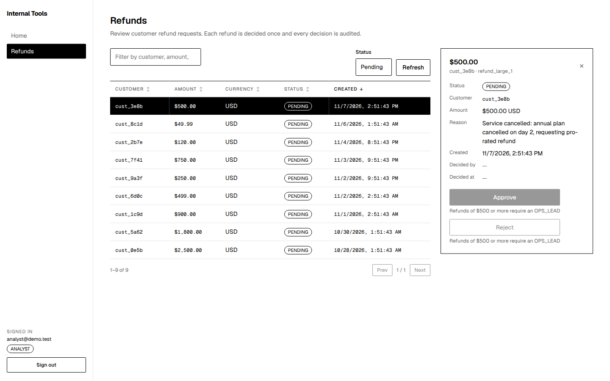
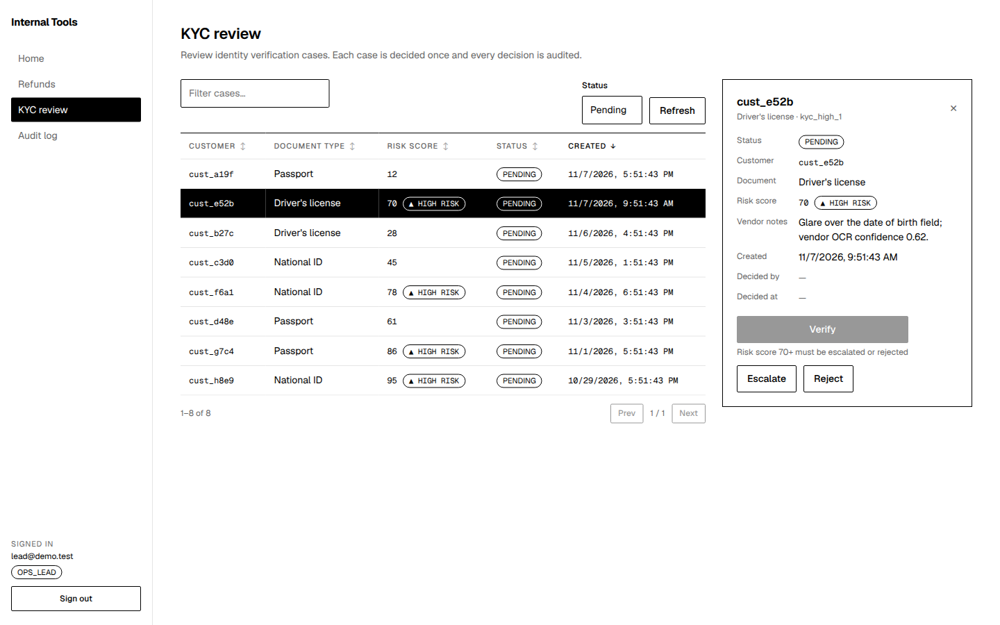
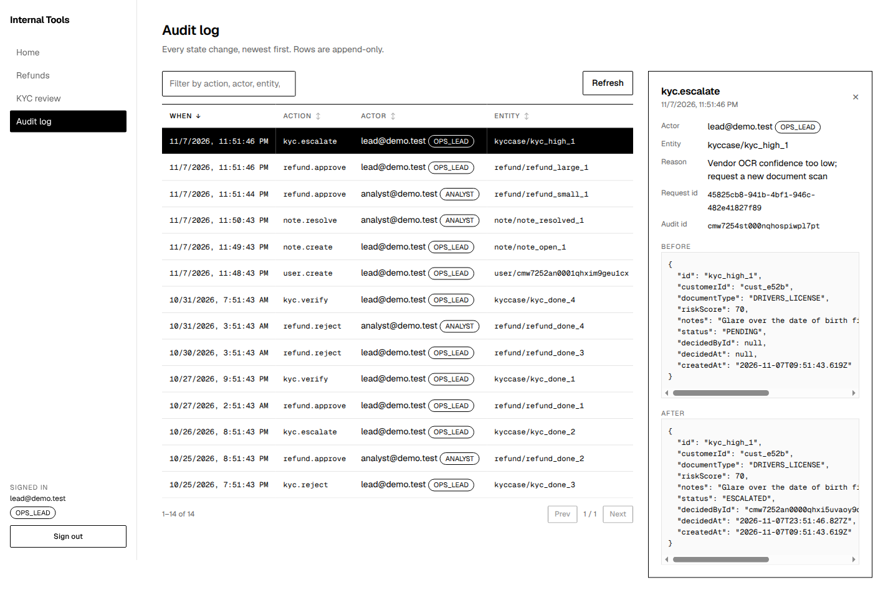

# internal-tools-foundation

## About this repo

This repo is the working prototype behind an evaluation of building internal
tools with Devin instead of a low-code platform. Start with:

- [`docs/EVALUATION.md`](docs/EVALUATION.md) — the evaluation and recommendation
- [`docs/DECISIONS.md`](docs/DECISIONS.md) — the decisions made along the way and why

Foundation for internal operations tools: stub auth with server-side roles, an
append-only audit log, a small monochrome UI kit, and a reference API handler
every future tool copies. Business tools are built on top of this from spec
files under `docs/tools/` (see `docs/adding-a-tool.md` and
`.devin/playbooks/new-tool.md`).

| Tool | Page | Spec |
| --- | --- | --- |
| Refund review queue | `/refunds` (ANALYST, OPS_LEAD) | `docs/tools/refunds.md` |
| KYC review queue | `/kyc` (OPS_LEAD) | `docs/tools/kyc.md` |

**Stack:** Next.js (App Router) · TypeScript · Prisma · SQLite · Vitest. No external services.

## Run

Prerequisites: Node 20.9 or newer, npm 10+.

```bash
npm run setup     # npm install, create .env, prisma migrate deploy, prisma generate, seed
npm run dev       # http://localhost:3000 → redirects to /login
```

Other scripts:

| Script | What it does |
| --- | --- |
| `npm test` | Vitest. Uses its own SQLite file (`prisma/test.db`), migrated + seeded fresh on every run |
| `npm run typecheck` / `npm run lint` | `tsc --noEmit` / ESLint |
| `npm run db:migrate` | `prisma migrate dev` — create a new migration from `prisma/schema.prisma` |
| `npm run db:seed` | Re-run `prisma/seed.ts` (idempotent) |
| `npm run db:reset` | Drop, re-migrate and re-seed the dev database |

## Demo logins

| Email | Password | Role | Sees |
| --- | --- | --- | --- |
| `lead@demo.test` | `lead123` | `OPS_LEAD` | Home, **Refunds** (`/refunds`, any amount), **KYC review** (`/kyc`), **Audit log** (`/audit`) |
| `analyst@demo.test` | `analyst123` | `ANALYST` | Home, **Refunds** (`/refunds`, may decide only refunds under $500) |

The seed adds 14 refunds with fixed ids (`refund_small_1..5` under $500, `refund_large_1..5` at $500 or more, `refund_done_1..4` already decided, with matching audit rows) and 12 KYC cases (`kyc_low_1..4` risk under 70, `kyc_high_1..4` risk 70+ which cannot be verified, `kyc_done_1..4` already decided, with matching audit rows).

## Demo walkthrough

Start from a fresh seed (`npm run db:reset`) and follow the steps in order; the
screenshots below were taken from the running app at each point.

1. Sign in as `analyst@demo.test`. Open **Refunds**. Select `refund_small_1`
   (customer `cust_4f2a`, $12) and approve it. Then select `refund_large_1`
   (customer `cust_3e8b`, $500): the Approve button is disabled with the reason
   "Refunds of $500 or more require an OPS_LEAD", and calling
   `POST /api/refunds/refund_large_1/approve` directly as the analyst returns
   `403`. The rule is enforced in the API; the disabled button only mirrors it.

   

2. Sign out, sign in as `lead@demo.test`. Open **Refunds** and approve
   `refund_large_1`.

3. Open **KYC review**. Select `kyc_high_1` (customer `cust_e52b`, risk 70):
   Verify is disabled with "Risk score 70+ must be escalated or rejected", and
   the API would answer `400` if called directly. Escalate it instead and enter
   a reason in the confirmation dialog.

   

4. Open **Audit log**. Every action above appears as `refund.approve` or
   `kyc.escalate` with the actor, their role, the full before/after row, the
   request id and the reason you entered.

   

## Layout

```
app/
  login/                 /login page (email + password → signed httpOnly cookie)
  (tools)/               everything behind sign-in, wrapped in AppShell
    page.tsx             /  home
    audit/               /audit — example page using every kit component
    refunds/             /refunds — refund review queue (docs/tools/refunds.md)
    kyc/                 /kyc — KYC review queue (docs/tools/kyc.md)
  api/
    auth/login, logout   session endpoints
    audit/route.ts       GET /api/audit (OPS_LEAD) — the READ example
    refunds/             GET /api/refunds, POST /api/refunds/[id]/approve|reject
    kyc/                 GET /api/kyc, POST /api/kyc/[id]/verify|escalate|reject
    _template/route.ts   reference WRITE handler — copy for each tool (not served; `_` = private folder)
components/              AppShell, QueueTable (sort/filter/paging), DetailPanel, ActionButton,
                         ConfirmDialog (collects a reason), TextField, SelectField
lib/
  auth.ts                getCurrentUser(), requireRole() + OIDC migration notes
  audit.ts               writeAudit() — the only write path to audit_log
  api.ts                 json(), error(), ApiError, withErrorHandling(), x-request-id
  write-route.ts         defineWriteRoute() — the six-step write route builder; audits for you
  nav.ts                 role-filtered nav entries
  db.ts                  Prisma client singleton
prisma/
  schema.prisma          users, audit_log, notes, refunds, kyc_cases
  migrations/            SQL migrations (audit_log has no-UPDATE / no-DELETE triggers)
  seed.ts                demo users, notes, refunds, KYC cases, sample audit rows (separate from migrations)
tests/                   Vitest: login, requireRole, writeAudit, _template handler, refunds, kyc
docs/adding-a-tool.md    checklist for building a new tool on this foundation
docs/governance.md       controls that are built in, and what production still needs
.devin/playbooks/        Devin playbook that drives new-tool builds
```

## Principles

- **Authorization lives in API routes.** Every handler starts with
  `requireRole(...)`. Wrong role → `403 { error: { code: "forbidden", ... } }`.
  The UI hides or disables controls for convenience, never as the check.
- **Every state change goes through `defineWriteRoute`**, which runs
  requireRole → zod → load → rules → `prisma.$transaction(mutate + writeAudit)`
  in that order. The audit row (actor + role, before/after, request id,
  reason) is written by the helper in the same transaction, so it cannot be
  skipped. `audit_log` is append-only — no update/delete code paths, and the
  database triggers refuse them anyway. See `docs/governance.md`.
- **Every response carries `x-request-id`**, which is also stored on the audit
  row, so a change can be traced from UI → API → log line.
- **One error shape** everywhere: `{ error: { code, message, details? } }`.
